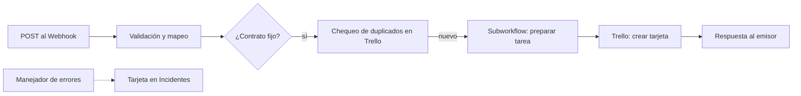

# Onboarding_n8n
Automatización del onboarding con n8n (Corte 2)

# Onboarding de colaboradores con n8n

Automatización del proceso de incorporación de nuevos colaboradores. Un sistema envía los datos del ingreso a un Webhook de n8n, que los valida, evita tareas duplicadas y crea la tarea inicial del área responsable (TI, RRHH u Operaciones) como tarjeta en Trello. Si algo falla, deja un registro en una lista de incidentes.

**Curso:** Automatización inteligente de procesos con n8n · EAM · 2026 II · Corte 2

**Integrantes:** Sofía Pérez Vanegas, Karol Dahiana Vanegas Arteaga, Valeria Cerón Muñoz, Manuela Camacho Llano, Juan Miguel Cerón Ocampo.

## Alcance actual

Funciona:
- Entrada por Webhook protegido con cabecera.
- Validación de campos obligatorios (400 si falta alguno).
- Regla de negocio: solo los contratos `fijo` generan tarea.
- Chequeo de duplicados contra Trello (409).
- Subworkflow que prepara la tarea según el área.
- Creación de la tarjeta con 3 reintentos y verificación del `id` (502 si falla).
- Manejador de errores que registra el incidente en Trello.

Limitaciones: los contratos `temporal` y `aprendiz` no generan tarea; no se envían correos ni avisos; los casos se envían a mano con datos ficticios; n8n corre en local. Detalle completo en la [bitácora unificada](documentacion/Bitacora_Unificada_Proyecto.md).

## Arquitectura



| Workflow | Archivo | Responsabilidad |
|---|---|---|
| Principal | `workflows/Principal_Onboarding.json` | Recibir, validar, decidir, crear la tarjeta y responder |
| Preparar_Tarea_Onboarding | `workflows/Preparar_Tarea_Onboarding.json` | Recibe `id_onboarding`, `nombre`, `area_responsable`, `tipo_contrato`; devuelve `id_onboarding`, `asunto`, `cuerpo`, `id_lista` |
| Manejador_Errores | `workflows/Manejador_Errores.json` | Registrar las ejecuciones fallidas en Trello |

Diagramas: [proceso manual](documentacion/diagramas/Proceso_Manual.png) y [proceso automatizado](documentacion/diagramas/Proceso_Automatizado.png).

## Requisitos

- n8n (versión: PENDIENTE), instalación local.
- Cuenta de Trello con una API Key y un Token con permisos de lectura y escritura.
- Un tablero de Trello con las listas `TI`, `RRHH`, `Operaciones` e `Incidentes`.

## Configuración

1. En Trello crea el tablero y las 4 listas. Obtén el ID del tablero y el `idList` de cada lista (por ejemplo, abriendo la dirección del tablero con `.json` al final).
2. En n8n crea dos credenciales con **tus propios valores**:
   - **Trello API**: tu API Key y tu Token.
   - **Header Auth** para el Webhook: nombre de cabecera `X-Onboarding-Key` y un valor secreto que tú inventes.
3. No escribas claves, tokens ni el valor de la cabecera en los nodos, ni los subas al repositorio.

## Importación y conexiones

Importa en este orden (Workflows → Import from file), guardando cada uno:

1. `Preparar_Tarea_Onboarding.json`
2. `Manejador_Errores.json`
3. `Principal_Onboarding.json`

Después de importar, hay que volver a seleccionar:
- En el nodo `Call 'Preparar_Tarea_Onboarding'` del principal: el subworkflow, de la lista.
- En **Settings** del principal → **Error workflow**: `Manejador_Errores`.
- La credencial **Trello API** en `GET tarjetas Trello`, `Crear tarjeta Trello` y el nodo de incidentes del manejador.
- La credencial **Header Auth** en el nodo Webhook.
- Los recursos: el ID del tablero en `GET tarjetas Trello` y los `idList` en los `Edit Fields` del subworkflow y en el manejador.

## Ejecución

- **Prueba:** en el principal, pulsa **Execute workflow** y envía la solicitud a la URL de prueba `http://localhost:5678/webhook-test/nuevo-colaborador`. Atiende una sola llamada por cada ejecución.
- **Producción:** publica el principal y usa `http://localhost:5678/webhook/nuevo-colaborador`. Despublícalo al terminar las pruebas.
- El resultado se ve en la respuesta HTTP, en **Executions** de n8n y en la lista del área en Trello.

## Prueba de ejemplo

Entrada ficticia (PowerShell; reemplaza `TU_VALOR_SECRETO` por el valor de tu credencial):

```powershell
$headers = @{ "X-Onboarding-Key" = 'TU_VALOR_SECRETO' }
$body = '{"nombre":"Lucía Ramírez","area":"TI","fecha_ingreso":"2026-11-09","tipo_contrato":"fijo"}'
Invoke-RestMethod -Method Post -Uri "http://localhost:5678/webhook-test/nuevo-colaborador" -Headers $headers -ContentType "application/json; charset=utf-8" -Body ([System.Text.Encoding]::UTF8.GetBytes($body))
```

Salida esperada: respuesta 200 y una tarjeta `Onboarding Lucía Ramírez · TI` en la lista TI. Si repites el mismo envío, responde 409 y no crea otra tarjeta. Si omites un campo, responde 400.

## Documentación y evidencias

- [Bitácora unificada](documentacion/Bitacora_Unificada_Proyecto.md)
- [Presentación en PDF](documentacion/Presentacion_Corte_2.pdf)
- [Diagramas](documentacion/diagramas/)
- [Evidencias de las pruebas](documentacion/evidencias/)
- [Bitácoras anteriores](documentacion/historial/)
