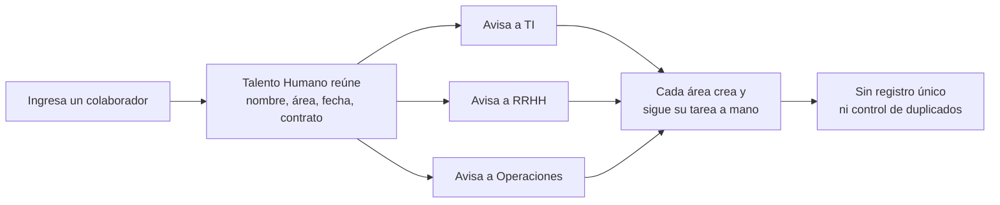
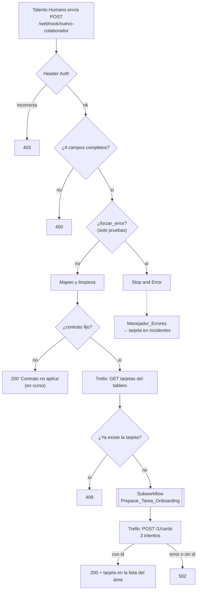

# Bitácora unificada — Onboarding de colaboradores

Este documento explica el **estado actual** de la solución. Las bitácoras de cada clase (C02–C08) quedan en `01_Bitácora/` como historial; donde no coinciden con este documento, vale este documento.

## 1. Identificación y alcance

| Campo | Registro |
| --- | --- |
| Proyecto | Onboarding de colaboradores |
| Equipo | Perez_Vanegas_Ceron_Camacho |
| Integrantes | Sofía Pérez Vanegas, Karol Dahiana Vanegas Arteaga, Valeria Cerón Muñoz, Manuela Camacho Llano, Juan Miguel Cerón Ocampo |
| Fecha de actualización | 2026-10-26 |
| Área dueña del proceso | Talento Humano |

### Problema

Cuando ingresa un colaborador, Talento Humano tiene que coordinar tareas y accesos con varias áreas: TI (usuario, accesos, equipo), RRHH (contrato, seguridad social, manual de convivencia) y Operaciones (puesto, dotación, inducción de seguridad). Cada área necesita saber qué le toca y para quién.

### Objetivo de la automatización

Recibir el registro de un nuevo ingreso y crear automáticamente la tarea inicial del área responsable en un tablero de Trello. La solución valida los datos, evita tareas duplicadas y deja registro cuando algo falla.

### Qué incluye esta versión

- Entrada por Webhook protegido con cabecera.
- Validación de campos obligatorios.
- Regla de negocio: solo contratos `fijo`.
- Chequeo de duplicados contra Trello.
- Preparación de la tarea en un subworkflow.
- Creación de la tarjeta en la lista del área, con reintentos y verificación del `id`.
- Registro de fallos en la lista `Incidentes`.

### Fuera del alcance

- Contratos `temporal` y `aprendiz`: se reciben, pero no generan tarea.
- Notificar por correo o chat a las áreas.
- Hacer seguimiento a si las tareas se completan.
- Conectar con un sistema real de Talento Humano: los casos se envían a mano con datos ficticios.
- Servidor público: n8n corre en el computador de cada integrante.

### Responsabilidades

| Integrante | Aportes principales |
| --- | --- |
| Sofía Pérez Vanegas | Tema del proyecto (C02); datos y regla `tipo_contrato` (C03); Form Trigger (C04); tablero de Trello e idList (C06); mapeo desde `body` (C07); integración final de C08, pruebas en producción y bitácoras |
| Karol Dahiana Vanegas Arteaga | Switch por área (C03); Edit Fields con expresiones e `id_onboarding` (C04); credenciales de Trello (C06); Header Auth (C07); reintentos, 502 y lista `Incidentes` (C08) |
| Valeria Cerón Muñoz | Casos de prueba (C03); If + Switch (C04); pruebas (C06); Webhook y validación 400 (C07); manejador de errores y fallo controlado (C08) |
| Manuela Camacho Llano | Bitácoras y evidencias (C03–C07); HTTP Request de Operaciones (C06); duplicados 409 (C07); subworkflow y principal con un solo POST (C08) |
| Juan Miguel Cerón Ocampo | Caso Operaciones (C03); salida útil (C04); HTTP Request TI/RRHH (C06); respuesta 200 (C07); cierre y export final (C08) |

## 2. Proceso manual y proceso automatizado

### Sin la automatización

Talento Humano recibe el ingreso y avisa a cada área por separado. Cada área crea y sigue su propia tarea. Puntos débiles:
- Se repite el mismo aviso para cada ingreso.
- Un área puede no enterarse.
- El mismo ingreso puede avisarse dos veces.
- No queda un registro único del inicio del onboarding.

No medimos tiempos del proceso manual. Estos son problemas esperados, no resultados medidos.



### Con n8n



## 3. Funcionamiento de la solución

### Entrada

Un `POST` con JSON al Webhook `nuevo-colaborador`, con la cabecera `X-Onboarding-Key`.

```json
{ "nombre": "Lucía Ramírez", "area": "TI", "fecha_ingreso": "2026-11-09", "tipo_contrato": "fijo" }
```

| Campo | Obligatorio | Valores |
| --- | :-: | --- |
| `nombre` | Sí | Texto |
| `area` | Sí | `TI`, `RRHH`, `Operaciones` |
| `fecha_ingreso` | Sí | `AAAA-MM-DD` |
| `tipo_contrato` | Sí | `fijo` genera tarea; otros valores no |
| `forzar_error` | No | Solo pruebas: `true` provoca el fallo controlado |

### Recorrido

1. **Validación (`If`).** Comprueba que los 4 campos existan y no estén vacíos:
   `['nombre','area','fecha_ingreso','tipo_contrato'].every(k => $json.body && $json.body[k] && String($json.body[k]).trim() !== '')`.
   Ejemplo: sin `fecha_ingreso` da `false` y la respuesta es 400.
2. **Mapeo (`Edit Fields`).** El Webhook entrega el JSON dentro de `body`, así que cada campo se lee de `$json.body` y se limpia con `trim()`. También genera `id_onboarding`:
   `"ONB-" + $json.body.area.trim() + "-" + $now.toFormat("yyyyLLdd-HHmmss")`.
   Ejemplo: `area: "TI"` a las 18:39:53 del 26/10 da `ONB-TI-20261026-183953`.
3. **Regla de negocio (`If tipo_contrato = fijo`).** Sin distinguir mayúsculas.
4. **Duplicados.** `GET /1/boards/{tablero}/cards?fields=name` → `Aggregate` (todas en `tarjetas`) → `Merge` (vuelve a unir el caso) → `If`:
   `$json.tarjetas.some(t => t.name.replace(/^=/, '').trim() === "Onboarding " + $json.nombre + " · " + $json.area_responsable)`.
   Si existe una tarjeta "Onboarding Lucía Ramírez · TI", da `true` → 409.
5. **Subworkflow.** Recibe `id_onboarding`, `nombre`, `area_responsable`, `tipo_contrato`; un Switch elige la rama del área y devuelve `id_onboarding`, `asunto`, `cuerpo`, `id_lista`. El principal espera su resultado.
6. **Creación (`HTTP Request`).** `POST /1/cards` con `idList = id_lista`, `name = asunto`, `desc = cuerpo`.
7. **Verificación (`If`).** `!!$json.id`: si Trello devolvió `id` → 200; si no → 502.

### Workflows

| Workflow | Responsabilidad | Recibe | Devuelve |
| --- | --- | --- | --- |
| Principal (`C08_Onboarding_Semana8`) | Orquestar: recibir, validar, decidir, crear y responder | POST del Webhook | 200, 400, 409 o 502 |
| `Preparar_Tarea_Onboarding` | Armar la tarea del área | 4 campos | `id_onboarding`, `asunto`, `cuerpo`, `id_lista` |
| `Manejador_Errores` | Registrar ejecuciones fallidas | Datos del Error Trigger | Tarjeta en `Incidentes` |

## 4. Integraciones y configuración

| Servicio | Función | Operaciones |
| --- | --- | --- |
| Webhook de n8n | Entrada de los casos | Recibe POST |
| Trello (API REST, vía HTTP Request) | Destino de las tareas y registro de incidentes | Lectura de tarjetas del tablero y creación de tarjetas |

| Llamada | Método y endpoint | Envía | Datos usados de la respuesta |
| --- | --- | --- | --- |
| `GET tarjetas Trello` | `GET https://api.trello.com/1/boards/{idTablero}/cards` | `fields=name` | `name` de cada tarjeta |
| `Crear tarjeta Trello` | `POST https://api.trello.com/1/cards` | `idList`, `name`, `desc` | `id` (verificación), `url` |
| `Crear tarjeta en Incidentes` | `POST https://api.trello.com/1/cards` | `idList` de Incidentes, `name`, `desc` | — |

La autenticación de Trello va en la credencial **Trello API** (API Key + Token), nunca en el nodo ni en la URL.

**Recursos que hay que preparar:** un tablero con las listas `TI`, `RRHH`, `Operaciones` e `Incidentes`, y sus idList en el subworkflow y en el manejador. Los IDs, las credenciales y el orden de importación están en [[C08_Nota_Importacion]].

**Webhook:**
- Método `POST`, ruta `nuevo-colaborador`, cabecera `X-Onboarding-Key` (credencial Header Auth).
- Responde desde el flujo con `Respond to Webhook`.
- URL de prueba: `/webhook-test/nuevo-colaborador`. Atiende una sola llamada después de *Listen for test event*.
- URL de producción: `/webhook/nuevo-colaborador`. Exige el workflow publicado.
- En C07 se usó un túnel de Cloudflare (`trycloudflare.com`) para exponer el n8n local. Esa dirección es temporal y cambia cada vez que se inicia el túnel.

## 5. Errores y recuperación

| Situación | Tipo | Resultado |
| --- | --- | --- |
| Cabecera ausente o incorrecta | Acceso | 403, sin ejecución |
| Faltan datos | Entrada inválida | 400, sin escribir en Trello |
| Contrato no fijo | Resultado del negocio | Sin tarea (respuesta 200 en curso) |
| Tarjeta ya existe | Resultado del negocio | 409, sin escribir |
| Trello falla | Fallo técnico | 3 intentos cada 2000 ms; luego 502 |
| Trello responde sin `id` | Resultado no verificable | 502; no se confirma éxito |
| Fallo no controlado | Fallo técnico | La ejecución se detiene; `Manejador_Errores` crea tarjeta en `Incidentes` |

- **Manejador asociado:** Settings del principal → Error workflow = `Manejador_Errores`.
- **Registro del fallo:** tarjeta en `Incidentes` con fecha y hora, proyecto, workflow, nodo, mensaje, estado `pendiente` y número de ejecución.
- **Recuperar una operación:** se revisa la ejecución indicada en la tarjeta, se corrige la causa y se reenvía el caso. Antes de reenviar se comprueba en el tablero si la tarjeta ya existe; el chequeo de duplicados responde 409 si ya se creó. El incidente pasa a `resuelto` solo después de verificar la tarjeta.
- **Límites conocidos:**
  - Un fallo de Trello que termina en 502 no crea incidente, porque se trata dentro del flujo y la ejecución no falla.
  - Un reintento después de una respuesta perdida puede crear una tarjeta duplicada.
  - El chequeo compara títulos exactos.

## 6. Pruebas y evidencias

| # | Caso | Ejecución | Entrada (ficticia) | Esperado | Observado | Evidencia |
| --- | --- | --- | --- | --- | --- | --- |
| P1 | Normal | Automática (producción), ej. 27 | Lucía Ramírez, TI, 2026-11-09, fijo | 200 y tarjeta en TI | 200; tarjeta `Onboarding Lucía Ramírez · TI` creada | `C08_P1_*.png`, https://trello.com/c/4A8pxsBQ |
| P2 | Incompleta | Automática, ej. 29 | Mateo Quintero, Operaciones, fijo, sin fecha | 400 sin escritura | 400; ningún nodo de Trello ejecutado | `C08_P2_*.png` |
| P3 | Duplicada | Automática, ej. 30 | Igual a P1 | 409 sin tarjeta nueva | 409 | `C08_P3_*.png` |
| P4 | Fallo controlado | Automática, ej. 31 → manejador ej. 32 | Tomás Herrera, RRHH, fijo, `forzar_error: true` | Tarjeta en Incidentes | Tarjeta `Incidente · C08_Onboarding_Semana8 · 2026-10-26 18:40:28` | `C08_P4_*.png`, https://trello.com/c/f8YjzNvH |
| P5 | Trello sin `id` | Manual con respuesta simulada, ej. 33 | Valentina Ospina, Operaciones, fijo | 502 | 502 | `C08_P5_*.png` |
| C07 | Sin cabecera | Prueba de C07 | Caso válido sin cabecera | 403 | 403 | `C07_SinAutenticacion_*.png` |

Detalle de pasos y conclusiones: bitácora [[C08_2026-10-25_Subworkflows_Errores_Registros]], sección 5.

## 7. Evolución y estado final

| Clase | Cambio |
| --- | --- |
| C02 | Ficha inicial y primer flujo `Manual Trigger → Edit Fields → If` |
| C03 | Datos del colaborador, regla `tipo_contrato = fijo` y Switch por área |
| C04 | Form Trigger, expresiones, `id_onboarding` y salida útil (`asunto`, `cuerpo`) |
| C05 | Defensa técnica |
| C06 | Integración con Trello (tablero, 3 listas, POST por rama) |
| C07 | Webhook con Header Auth, validación 400, duplicados 409, respuesta 200 |
| C08 | Subworkflow, un solo POST, reintentos + 502, manejador con lista `Incidentes` |

**Decisiones importantes:**
- Trello como destino (C06).
- Responder desde el flujo (C07).
- Comparar duplicados por título (C07).
- Subworkflow con contrato fijo y un solo POST (C08).
- Registrar fallos en Trello (C08).

**Dificultades y cómo se resolvieron:**
- Cada integrante tiene su propia instalación: se trabaja por export/import y se reseleccionan credenciales y subworkflows.
- Títulos con `=` y saltos de línea en tarjetas antiguas: el subworkflow nuevo arma el asunto con `trim()`.
- Exports incompletos en C08: se reconstruyeron el subworkflow y el manejador en una cuenta y se repitieron las pruebas.

**Uso de IA:** Claude se usó para revisar exports y evidencias, reconstruir en la cuenta de Sofía el subworkflow, el manejador y el fallo controlado mediante el conector de n8n, ejecutar las pruebas de C08 y redactar las bitácoras. Los resultados se verificaron en el historial de ejecuciones de n8n y en las tarjetas de Trello.

### Implementado

- Webhook con Header Auth.
- Validación 400.
- Regla de contrato fijo.
- Duplicados 409.
- Subworkflow `Preparar_Tarea_Onboarding`.
- POST a Trello con 3 reintentos, verificación de `id` y 502.
- `Manejador_Errores` con registro en `Incidentes`.

### Simulado

| Qué | Cómo |
| --- | --- |
| Colaboradores | Datos ficticios |
| Sistema de origen | POST desde PowerShell o desde el conector de n8n |
| Herramientas de cada área | Una lista de Trello por área |
| Fallo del sistema | `forzar_error: true` → Stop and Error |
| Respuesta sin `id` de Trello (P5) | Salida fijada en el editor |
| Producción | n8n local, publicado solo durante las pruebas |

### Propuesto

| Mejora | Motivo |
| --- | --- |
| Respuesta 200 en la rama de contrato no fijo | Hoy no hay respuesta (en curso, Miguel) |
| Validar que `area` sea TI, RRHH u Operaciones | Con otra área el cliente no recibe respuesta (P6 de C08) |
| Incidente también desde la rama 502 | Los fallos de Trello no quedan en `Incidentes` |
| Llave de duplicado estable y normalizada | Evitar duplicados por diferencias de formato |
| Flujo para contratos temporal y aprendiz | El proceso real los incluye |
| Aviso al responsable y cambio de estado del incidente | Hoy el registro existe pero nadie es notificado |
| Instancia de n8n compartida | Evitar reseleccionar credenciales y subworkflows |
