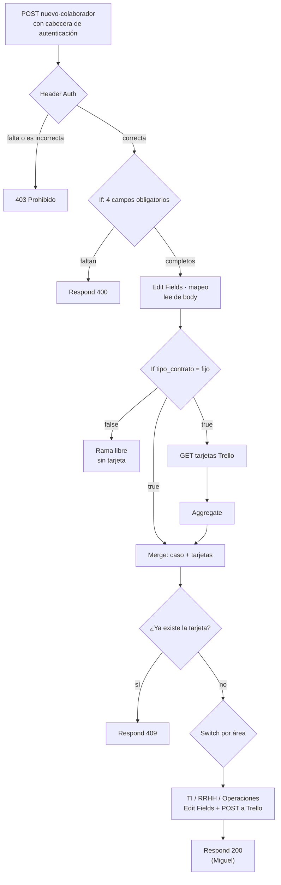

# Bitácora — Clase [07]

## 1. Datos de la sesión

| Campo    | Registro                                                                                                                                              |
| -------- | ----------------------------------------------------------------------------------------------------------------------------------------------------- |
| Tema     | Webhooks — recibir los casos de onboarding por POST, protegerlos y validarlos                                                                         |
| Objetivo | Sustituir el Form Trigger por un Webhook protegido con Header Auth, validar la entrada, evitar tarjetas duplicadas en Trello y probar todos los casos |
| Proyecto | Onboarding                                                                                                                                            |
| Inicio   | 6:00 pm                                                                                                                                               |
| Cierre   | 8:30 pm                                                                                                                                               |

## 2. Participación y responsabilidades

| Integrante                    | Asistió | Rol de la clase              | Responsabilidad asumida                                                                                                               | Aporte verificable                                                                                                  |
| ----------------------------- | ------- | ---------------------------- | ------------------------------------------------------------------------------------------------------------------------------------- | ------------------------------------------------------------------------------------------------------------------- |
| Valeria Cerón Muñoz           | Sí      | Webhook y validación         | Agregar el Webhook (POST, `nuevo-colaborador`, Respond to Webhook) y un `If` que revisa los 4 campos; si falta alguno responde 400    | Nodos `Webhook nuevo-colaborador`, `If` y `Respond to Webhook` en el JSON del workflow. Capturas propias: PENDIENTE |
| Sofía Pérez Vanegas           | SÍ      | Mapeo desde `body`           | Cambiar las expresiones de `Edit Fields · mapeo (Karol)` para leer de `$json.body` y mapear también `tipo_contrato` y `fecha_ingreso` | `C07_FIELDS.png`, `C07_OUTPUT.png`                                                                                  |
| Karol Dahiana Vanegas Arteaga | Sí      | Protección de la entrada     | Activar Header Auth en el Webhook y probar con y sin cabecera                                                                         | `C07_Pruebawebhook.md` (2 capturas de Postman, ver sección 5)                                                       |
| Manuela Camacho Llano         | Sí      | Duplicados y pruebas finales | Verificar si la tarjeta ya existe en Trello (respuesta 409), ejecutar las pruebas finales, bitácora, diagrama y evidencias            | 12 capturas `C07_*` en `03_Capturas/` (sección 6)                                                                   |
| Juan Miguel Cerón Ocampo      | Sí      | Respuesta de éxito           | Agregar `Respond to Webhook` con código 200 después de crear la tarjeta                                                               | `C07_Respuesta200_Hoppscotch.jpeg`, `C07_Respuesta200_Nodo.jpeg`                                                    |

## 3. Reto aplicado al proyecto

### Funcionalidad trabajada

Cambiar la entrada del workflow: en vez del formulario, el Onboarding recibe cada caso como un POST con JSON en el Webhook `nuevo-colaborador`. La entrada se autentica con Header Auth, se valida, se revisa que no exista ya una tarjeta igual en Trello y solo entonces pasa al Switch por área y crea la tarjeta.

### Contrato de la entrada

Pruebas: `POST http://localhost:5678/webhook-test/nuevo-colaborador`. Producción: la misma ruta con `/webhook/` (workflow publicado).

Cuerpo JSON, los 4 campos son obligatorios:

```json
{ "nombre": "Ana Perez", "area": "TI", "fecha_ingreso": "2026-10-20", "tipo_contrato": "fijo" }
```

| Situación                     | Respuesta                                                          | Quién la produce                                        |
| ----------------------------- | ------------------------------------------------------------------ | ------------------------------------------------------- |
| Cabecera ausente o incorrecta | 403 Prohibido                                                      | El Webhook (Header Auth), antes de ejecutar el workflow |
| Faltan campos                 | 400 `{"error": "Faltan campos obligatorios", "requeridos": [...]}` | `If` + `Respond to Webhook` (Valeria)                   |
| La tarjeta ya existe          | 409 `{"error": "Colaborador ya registrado"}`                       | Verificación de duplicados (Manuela)                    |
| Caso válido                   | 200 `{"recibido": true, "mensaje": "Onboarding iniciado"}`         | `Respond to Webhook` final (Miguel)                     |

> El nombre y el valor de la cabecera no se registran en esta bitácora.

### Flujo



### Criterios de aceptación

- [x] Webhook POST con path `nuevo-colaborador` y Respond to Webhook.
- [x] Validación de campos obligatorios (respuesta de error con el mensaje claro).
- [x] Mapeo leyendo desde `body`.
- [x] Header Auth: sin cabecera n8n responde 403.
- [x] Verificación de duplicados (respuesta "Colaborador ya registrado").
- [x] Pruebas: válida, incompleta, duplicada y sin autenticación.
- [x] Ejecuciones del workflow publicado visibles en Executions.
- [x] `Respond to Webhook` 200 final (Miguel), probado con área TI.
- [x] Workflow final exportado en `02_Workflows/`.

### Archivos o componentes modificados

- Workflow `C07_Onboarding_Semana7`: nodos nuevos `Webhook nuevo-colaborador`, `If`, `Respond to Webhook` (400), `GET tarjetas Trello`, `Aggregate`, `Merge`, `¿Ya existe la tarjeta?` y `Respond to Webhook1` (409).
- `Edit Fields · mapeo (Karol)`: expresiones cambiadas a `$json.body.*`.
- `Form Onboarding`: desactivado (no eliminado).
- `Respond to Webhook2` (Miguel): responde 200 con `{"recibido": true, "mensaje": "Onboarding iniciado"}` después de crear la tarjeta.

## 4. Decisiones técnicas

| Decisión                                                  | Razón                                                                                                                              | Alternativa descartada                                  |
| --------------------------------------------------------- | ---------------------------------------------------------------------------------------------------------------------------------- | ------------------------------------------------------- |
| Responder desde el flujo con `Respond to Webhook`         | Permite devolver 400, 409 y (después) 200 según el caso, en vez de una respuesta fija                                              | Respuesta automática del Webhook                        |
| Desactivar el Form Trigger en vez de borrarlo             | El mapeo ahora lee `$json.body.*` y el formulario no entrega `body`; se conserva el nodo de las semanas anteriores                 | Borrarlo o dejarlo activo en paralelo                   |
| Header Auth en el Webhook                                 | n8n rechaza con 403 antes de ejecutar el workflow, y el secreto vive en Credentials (no en nodos ni capturas)                      | Webhook abierto (Authentication: None)                  |
| Una sola verificación de duplicados antes del Switch      | Un solo bloque (GET → Aggregate → Merge → If) en vez de repetirlo por rama; el Merge devuelve el caso original junto con las tarjetas, así los nodos siguientes no cambian | Repetir GET + If en cada rama |
| Comparar por título (`asunto`)                            | Es el dato que ya se guarda como `name` en Trello; `id_onboarding` cambia en cada ejecución y nunca coincidiría                    | Comparar por `id_onboarding`                            |

## 5. Problemas y soluciones

| Problema encontrado                                                                                                 | Causa identificada                                                                                                           | Solución aplicada                                                                                                                                             | ¿Cómo se verificó?                                                                                                    |
| ------------------------------------------------------------------------------------------------------------------- | ---------------------------------------------------------------------------------------------------------------------------- | ------------------------------------------------------------------------------------------------------------------------------------------------------------- | --------------------------------------------------------------------------------------------------------------------- |
| En la segunda captura de Karol la llamada devolvió 404 "webhook not registered" y no un rechazo por autenticación   | La URL de prueba (`/webhook-test/`) solo atiende una llamada después de *Listen for test event*; la segunda no tenía escucha | Activar *Listen for test event* antes de cada llamada de prueba. El rechazo real por falta de cabecera (403) se documentó con la prueba de Manuela            | `C07_SinAutenticacion_PowerShell.png` (403 Prohibido) y `C07_SinAutenticacion_Canvas.png` (el workflow no se ejecutó) |
| Al importar el workflow de otra cuenta, el Webhook queda apuntando a la credencial Header Auth de esa cuenta        | Las credenciales no viajan en el export del workflow                                                                         | Crear la credencial Header Auth en la cuenta propia. El valor del secreto se comparte por privado, no por el grupo ni por Drive                               | POST con cabecera correcta pasa; sin cabecera responde 403                                                            |
| En la captura de Sofía (`C07_OUTPUT.png`) la ejecución completa aparece con error, aunque el mapeo salió en Success | Por confirmar (probable: credencial de Trello no configurada en su cuenta al importar el workflow)                           | PENDIENTE confirmar con Sofía                                                                                                                                 | El nodo `Edit Fields · mapeo (Karol)` muestra Success y su OUTPUT correcto                                            |
| En el historial de Executions hay una ejecución con error (16:53:15, 1.054 s) antes de las exitosas                 | PENDIENTE                                                                                                                    | PENDIENTE                                                                                                                                                     | `C07_Produccion_Executions.png`                                                                                       |
| Las tarjetas de TI y RRHH creadas en C06 tienen un `=` al inicio del título                                         | Doble `=` en los campos `name`/`desc` de `HTTP Request1` y `HTTP Request2`                                                   | No se corrigió. Una comparación exacta de título no las reconocería como duplicadas; las pruebas de tarjeta de esta clase se hicieron con el área Operaciones | Capturas de Trello de las pruebas válida, válida 2 y producción (todas en Operaciones)                                |
| La rama false de `If tipo_contrato = fijo` sigue sin conectar                                                       | Diseño heredado de Semana 4                                                                                                  | Se deja abierto: un caso con contrato distinto de fijo no crea tarjeta ni pasa por ningún `Respond to Webhook`. Decisión pendiente con el equipo              | Estructura del workflow                                                                                               |

## 6. Evidencias

| Tipo    | Descripción                                                                                                                               | Enlace o ruta                                     |
| ------- | ----------------------------------------------------------------------------------------------------------------------------------------- | ------------------------------------------------- |
| Captura | Mapeo con expresiones `$json.body` y su OUTPUT (Sofía)                                                                                    | `03_Capturas/C07_FIELDS.png`                      |
| Captura | Webhook → mapeo con OUTPUT en el log de ejecución (Sofía)                                                                                 | `03_Capturas/C07_OUTPUT.png`                      |
| Nota    | Dos capturas de Postman de Karol (llamada con 200 OK y llamada con 404). Están en su carpeta de adjuntos, falta pasarlas a `03_Capturas/` | `03_Capturas/C07_Pruebawebhook.md`                |
| Captura | Prueba válida: recorrido del caso por el flujo                                                                                            | `03_Capturas/C07_PruebaValida_Canvas.png`         |
| Captura | Prueba válida: tarjeta de Laura Gómez creada en la lista Operaciones                                                                      | `03_Capturas/C07_PruebaValida_Trello.png`         |
| Captura | Prueba incompleta: respuesta "Faltan campos obligatorios"                                                                                 | `03_Capturas/C07_PruebaIncompleta_PowerShell.png` |
| Captura | Prueba incompleta: recorrido por el flujo                                                                                                 | `03_Capturas/C07_PruebaIncompleta_Canvas.png`     |
| Captura | Sin autenticación: 403 Prohibido                                                                                                          | `03_Capturas/C07_SinAutenticacion_PowerShell.png` |
| Captura | Sin autenticación: el workflow queda en "Waiting for you to call the Test URL" (no se ejecutó)                                            | `03_Capturas/C07_SinAutenticacion_Canvas.png`     |
| Captura | Prueba duplicada: respuesta "Colaborador ya registrado"                                                                                   | `03_Capturas/C07_PruebaDuplicada_PowerShell.png`  |
| Captura | Prueba duplicada: el GET devuelve 10 tarjetas y el caso termina en el Respond de duplicado                                                | `03_Capturas/C07_PruebaDuplicada_Canvas.png`      |
| Captura | Segunda entrada válida (Camila Ríos): tarjeta creada, el chequeo no bloquea casos distintos                                               | `03_Capturas/C07_PruebaValida2_Trello.png`        |
| Captura | Segunda entrada válida: recorrido por el flujo                                                                                            | `03_Capturas/C07_PruebaValida2_Canvas.png`        |
| Captura | Producción: historial de Executions (ejecución #37 exitosa, 17:04:10)                                                                     | `03_Capturas/C07_Produccion_Executions.png`       |
| Captura | Producción: tarjeta de Diego Torres creada en Operaciones                                                                                 | `03_Capturas/C07_Produccion_Trello.png`           |
| Captura | Respuesta de éxito: POST con área TI devuelve 200 OK y `{"recibido": true, "mensaje": "Onboarding iniciado"}` (Miguel)                    |                                                   |
| Captura | Nodo `Respond to Webhook2`: código 200, cuerpo JSON y entrada desde `HTTP Request4` (Miguel)                                              | `03_Capturas/C07_Respuesta200_Nodo.png`           |
| Captura | Webhook configurado, OUTPUT con `body` e `If` de validación (Valeria)                                                                     | `03_Capturas/C07_Respuesta200_Hoppscotch.jpeg`    |
| Código  | Exportación final del workflow                                                                                                            | `02_Workflows/C07_Onboarding_Semana7.json`        |

> ⚠️ Ninguna captura debe mostrar el valor de la cabecera ni el API Key o Token de Trello.

## 7. Uso de inteligencia artificial

| Herramienta | Objetivo o pregunta                                                  | Qué se utilizó                                                                    | Cómo se verificó                                          | Qué se modificó |
| ----------- | -------------------------------------------------------------------- | --------------------------------------------------------------------------------- | --------------------------------------------------------- | --------------- |
| Claude      | Organizar las evidencias de Semana 7 y redactar esta bitácora        | Revisión del workflow exportado y de las capturas en `03_Capturas/` para armar las tablas | Cada dato se contrastó con las capturas y con el JSON | PENDIENTE       |

## 8. Defensa técnica

- **¿Por qué sin cabecera no aparece ninguna ejecución?** Porque n8n valida el Header Auth antes de arrancar el workflow y responde 403 por su cuenta; en el canvas solo se ve "Waiting for you to call the Test URL".
- **¿Por qué `$json.body`?** El Webhook entrega `headers`, `params`, `query` y `body`; el JSON que manda el cliente llega dentro de `body`, por eso el mapeo cambió.
- **¿Cómo se evita la tarjeta duplicada?** Se piden las tarjetas de la lista a Trello, se juntan en una sola lista (Aggregate), se unen al caso original (Merge) y un `If` compara si algún título es igual a "Onboarding nombre · área". Si existe, responde 409; si no, sigue al Switch.
- **¿Por qué hay un Merge?** El `HTTP Request` reemplaza los datos del caso por la respuesta de Trello; el Merge vuelve a juntarlos para que el Switch y los nodos siguientes sigan leyendo lo mismo.
- **¿Qué diferencia hay entre Test URL y Production URL?** La de prueba atiende una sola llamada después de *Listen for test event*; la de producción exige el workflow publicado y cada llamada queda en Executions.
- **Limitaciones abiertas:** el `=` en los títulos de TI/RRHH y la rama false del `If tipo_contrato` (sección 5).

## 9. Pendientes antes de entregar

- [x] Miguel: confirmar que el 200 también responde en las ramas RRHH y Operaciones y pasar el export final.
- [ ] Karol: copiar sus 2 capturas a `03_Capturas/` con nombre `C07_...` y corregir los enlaces de `C07_Pruebawebhook.md`.
- [x] Subir el workflow final a `02_Workflows/`.
- [x] Completar Inicio, Cierre y asistencia.
- [x] Revisar que ninguna captura muestre secretos.